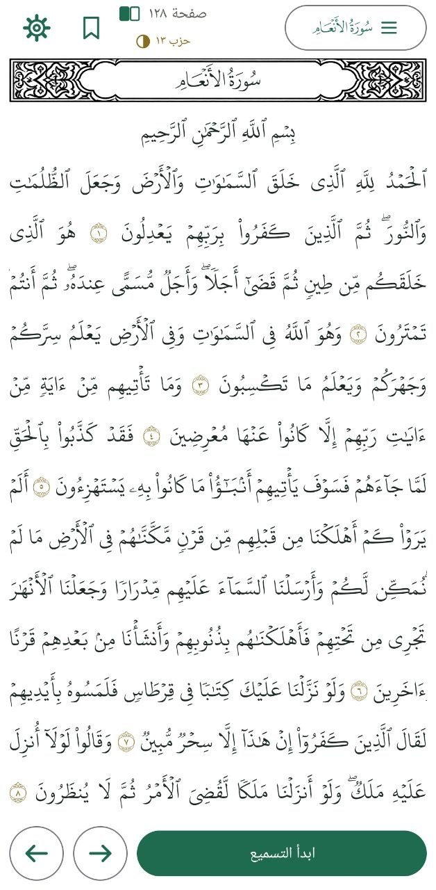
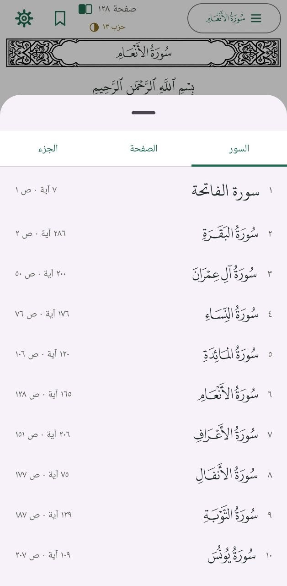
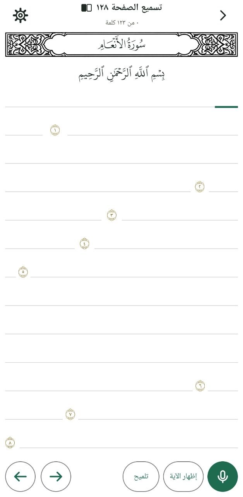
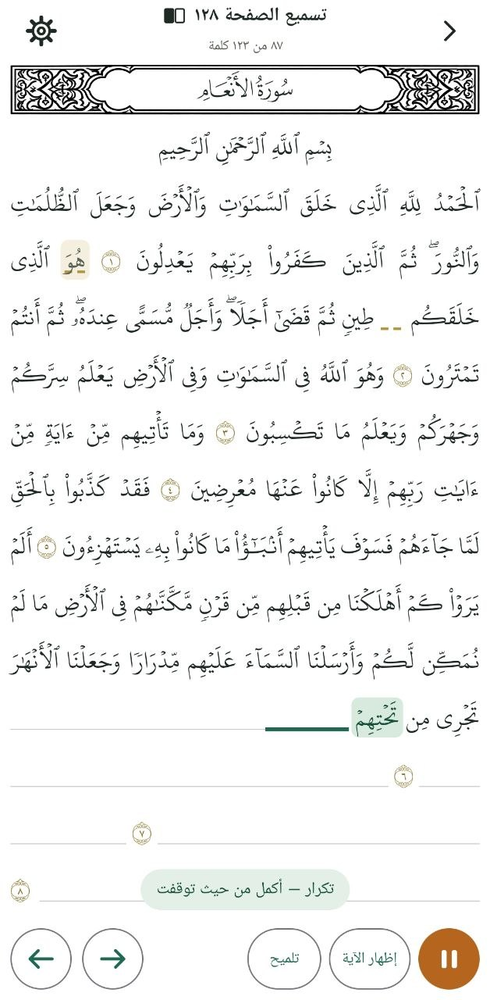
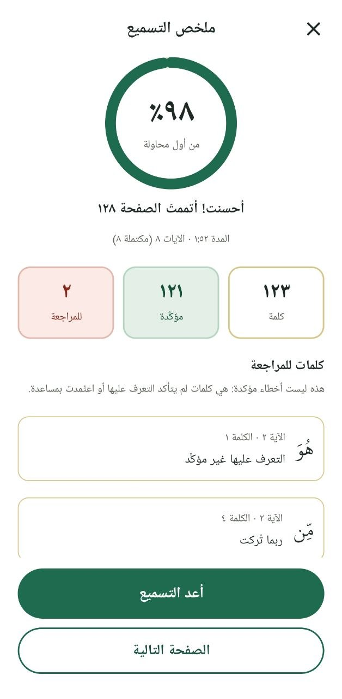
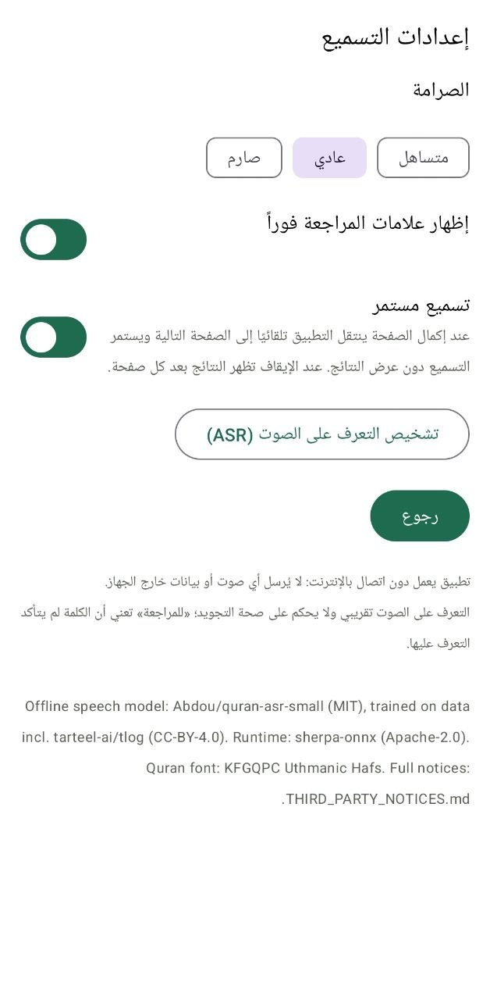

<div align="center">


# تسميع — Quran Tasmee3

**An offline Android app for reading the Madani Mushaf and testing your Quran memorisation by voice.**

[](../../actions/workflows/android.yml)
&nbsp;·&nbsp; Android 8.0+ &nbsp;·&nbsp; No internet permission &nbsp;·&nbsp; Kotlin + Jetpack Compose

</div>

## What is this?
**تسميع (Tasmee3)** is the Arabic word for reciting the Quran from memory to a listener. This app plays the listener:
you open a page of the Mushaf, the words are hidden, you recite out loud, and each word appears on the page as the
app hears it. Everything runs **on your phone**: the speech recogniser, the Quran text and the page layout are
packaged inside the APK. There is no account, no cloud, no analytics, and the app does not even request the
`INTERNET` permission, so your voice never leaves the device.

This repository contains the complete Android project and the GitHub Actions workflow that builds the APK.

## Screenshots
| Reading | Navigate (Surah / Page / Juz) | Recitation (words hidden) |
|:---:|:---:|:---:|
|  |  |  |
| Standard 15-line Mushaf page, juz/hizb label | Jump to any surah, page or juz | Hidden words, controls |

| Recitation (live reveal) | Session summary | Settings |
|:---:|:---:|:---:|
|  |  |  |
| Words appear as you recite | Progress and words for review | Strictness, continuous mode, diagnostics |

## Features
**Mushaf reader**
- Full Madani Mushaf (Hafs, King Fahd Complex print): **604 pages × 15 lines**, exact page and line layout, KFGQPC Uthmanic Hafs font.
- **تسميع مستمر (Continuous recitation)**, a switch in Settings: on = finishing a page moves to the next page and recitation goes on without the results screen; off = results after every page.
- **Bookmark:** long-press any ayah to **copy it** or **save it as the bookmark** (one bookmark; a new one replaces the old). The bookmark icon next to the gear jumps back to that ayah and highlights it.
- Surah headings in the decorative frame, with surah names drawn in a dedicated surah-name font.
- **Navigation button** with three tabs: **Surahs** (all 114, with page numbers), **Page** (1–604, Arabic or western digits) and **Juz** (1–30). Swipe or use the arrow buttons to turn pages. The app reopens on the last page you were on.

**Recitation mode**
- Page words are hidden and replaced by a thin, continuous gray underline that follows the real position and width of the unrevealed words; revealed words appear in place with full diacritics and **nothing moves or reflows**.
- Live, on-device speech recognition reveals each word as you recite it, with partial skips and uncertain words marked for review.
- **Auto-pause:** if the microphone hears no speech for **1 minute**, recitation pauses by itself; press the button to resume.
- **One microphone button** for start, pause and resume: green mic (ready), amber pause icon (recording), blue play icon (paused). Pausing really stops the microphone, and resuming continues from the same word.
- **تلميح (Hint)** reveals the next word.
- **إظهار الآية (Show ayah)** reveals the current ayah; each further press reveals the next ayah, moving on to the next page automatically when needed, without stopping the session.
- Tap any word to start from there or to reveal just that word.
- The arrow buttons move to the next/previous page without leaving recitation. The Quran page keeps the same size and position as in the reader.
- Session summary: progress and a list of words **للمراجعة** (for review).

**Other**
- **Juz/Hizb indicator** under the page number: `جزء N · حزب N` plus a drawn pie for ¼ / ½ / ¾ of the hizb or the start of a hizb, taken from the **last ayah on the page**, so when a new quarter starts inside the page the label shows that new quarter (and its juz); data is the complete 240-quarter table in `qpc-hafs.db` (`python3 tools/validate_hizb_quarters.py` checks it).
- Open-book icon next to the page number shows the side of the Mushaf spread: odd pages are the right page, even pages the left page.
- Welcome page with the Basmala, white background like a printed Mushaf, Arabic right-to-left interface.
- Settings: recitation strictness (lenient / normal / strict), show review marks immediately, ASR diagnostics.

## Install
1. Open the **[Releases](../../releases)** page and download the latest `Quran-Tasmee3-*.apk`.
2. Copy it to your phone and open it (allow *Install unknown apps* for your browser/file manager when asked).
3. Android 8.0 (API 26) or newer; arm64-v8a, armeabi-v7a and x86_64 are included. The APK is large (~100 MB) because it contains the offline speech model.
4. On the first recitation, grant the **microphone** permission.

## How to use
1. Open the navigation button (top) and pick a surah, page or juz.
2. Press **ابدأ التسميع** to enter recitation mode for that page.
3. Press the microphone button and recite. Pause or resume with the same button.
4. Stuck? Press **تلميح** for one word, or **إظهار الآية** for the whole ayah.
5. Finish the page (or go back) to see the summary of words to review.

## Accuracy and limitations
- Speech recognition is **approximate**. The app does **not** judge Tajweed. Words marked "للمراجعة" are words whose recognition was uncertain or skipped, not confirmed mistakes.
- Results depend on the microphone, the room and the reciter; the model is a compact offline one (`quran-asr-small`).
- Recitation mode works one page at a time; leaving a page by the arrows does not carry its progress into the summary.
- See [`FINAL_QA_REPORT.md`](FINAL_QA_REPORT.md) for what has and has not been verified, and [`THIRD_PARTY_NOTICES.md`](THIRD_PARTY_NOTICES.md) before redistributing (font and data licences).

## Get the APK from GitHub Actions
1. Push to `main`/`master` (or open **Actions → Android CI → Run workflow**).
2. When the **build** job finishes, open the run and download the artifact **`Quran-Tasmee3-debug`**
   (it contains `Quran-Tasmee3-debug.apk`, roughly 100 MB because it bundles the 36 MB model and native libraries for 3 ABIs).
3. Unzip it and install the APK.

**Releases are automatic:** pushing a new `versionName` to `main` builds the app, tags `v<versionName>` and publishes a GitHub Release with the APK attached; see [`docs/RELEASING.md`](docs/RELEASING.md).

### Optional signed release APK
Add these repository secrets (Settings → Secrets and variables → Actions): `RELEASE_KEYSTORE_BASE64`
(`base64 -w0 your.jks`), `RELEASE_KEYSTORE_PASSWORD`, `RELEASE_KEY_ALIAS`, `RELEASE_KEY_PASSWORD`. Then push a tag
`v*` or run the workflow manually with *release = true*; the artifact is `Quran-Tasmee3-release`.
Without the secrets the release job is skipped. Keystores are git-ignored; nothing secret is stored in the repo.

## Build locally
Requires JDK 17 and the Android SDK (platform 34).
```
bash tools/fetch_asr_assets.sh      # once: ASR model (36 MB) + sherpa-onnx native libs; pinned + SHA-256 verified
./gradlew testDebugUnitTest         # JVM tests
./gradlew assembleDebug             # app/build/outputs/apk/debug/Quran-Tasmee3-debug.apk
```
The fetch step is build-time only. Without it the app still builds but the speech engine reports `ModelMissing`.
Python checks (no dependencies beyond the standard library): `python3 tools/validate_quran_data.py`,
`tools/check_mushaf_structure.py`, `tools/check_model_alphabet.py`, `tools/export_test_pages.py --check`.

## Architecture
```
AudioRecord 16 kHz ─▶ UtteranceSegmenter ─▶ ChunkedRecognitionPipeline ─▶ sherpa-onnx (quran-asr-small, INT8)
        speech/asr/                                                      │ SpeechEvent.Partial / Final
                                                                         ▼
 qpc-hafs.db + quran-index.db ─▶ SqliteQuranRepository ─▶ QuranPage ─▶ TrackingRecitationMatcher (recitation/)
        data/                                         │                  │ RecitationProgress
                                                      ▼                  ▼
                                              MushafPage (ui/mushaf) ◀── toWordVisuals ── RecitationScreen ─▶ SessionSummary
```
| Package | Role |
|---|---|
| `data` | Canonical vocalized text from `qpc-hafs.db`; 15-line layout + word ids from `qpc-v1-15-lines.db` via the generated `quran-index.db` (`tools/build_quran_index.py`). |
| `ui/mushaf` | Page renderer: KFGQPC Hafs font, `surah_header_bg.png` headers, justified lines, per-word visual states. |
| `speech/asr` | Offline ASR engine (chunked, not true streaming), capture, VAD segmentation, model installer. |
| `recitation` | Arabic folding, word alignment, state machine. Never generates text; only reports word ids/states. |
| `session`, `settings`, `di`, `ui` | Summary model, preferences, manual DI (`AppContainer`), screens/navigation. |

## Offline behaviour
No `INTERNET` permission (CI fails the build if it ever appears); the model and native libraries are packaged in the
APK and copied/verified locally on first run; there is no download code. Not yet confirmed on a device in airplane
mode (see QA report).

## Licences and attribution
See [`THIRD_PARTY_NOTICES.md`](THIRD_PARTY_NOTICES.md). Redistribution rights for the font and the Quran data were
**not** independently verified; read the notes there before publishing the app.

## Docs
`docs/RELEASING.md` (how to publish a release) · `docs/design/` (UI boards) · `docs/handoffs/` (per-agent technical notes: data layer, mushaf, ASR, matching) ·
`docs/mushaf-previews/` (Python-rendered layout previews, not Android screenshots).
